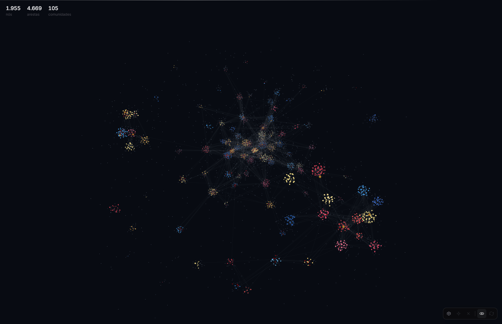

<div align="center">


# Graph Visuals

**Uma IDE leve em que o código é um grafo 3D e os agentes de IA trabalham ao lado dele.**

Veja a estrutura do projeto como uma constelação, acompanhe em tempo real os arquivos que cada agente está alterando e use os CLIs originais (Claude Code, GitHub Copilot, Codex, OpenCode, Kiro) sem nenhuma intermediação.




</div>

> **English summary.** Graph Visuals is a lightweight desktop IDE (Tauri 2 + Rust + React) where your codebase is rendered as an interactive 3D knowledge graph built by [Graphify](https://pypi.org/project/graphifyy/). AI coding agents run as their *original* CLIs in real terminals, untouched: the IDE never injects prompts, arguments, environment variables or context. When an agent writes files, the matching nodes light up in the graph. UI is in Brazilian Portuguese; contributions in English are welcome.

---

## Sumário

- [Por que](#por-que)
- [Recursos](#recursos)
- [Princípios](#princípios)
- [Instalação](#instalação)
- [Uso](#uso)
- [Atalhos](#atalhos)
- [Arquitetura](#arquitetura)
- [Estrutura do repositório](#estrutura-do-repositório)
- [Contribuindo](#contribuindo)
- [Roadmap](#roadmap)
- [Créditos](#créditos)
- [Licença](#licença)

## Por que

Agentes de IA editam muitos arquivos rápido, e em uma árvore de diretórios é difícil perceber *onde* eles estão mexendo e *o que mais* depende disso. No Graph Visuals o grafo é a tela principal: cada arquivo, função e conceito é um nó, as comunidades aparecem como aglomerados, e a atividade dos agentes acende o grafo enquanto acontece.

## Recursos

**Grafo 3D do projeto**
- Gerado pelo Graphify e renderizado com three.js (WebGL, shaders próprios), pensado para milhares de nós.
- Layout orgânico por comunidades: nem esfera, nem disco; grupos bem separados. Vista padrão isométrica.
- Paleta própria com proporções definidas (dourado para identidade e hubs, vermelho para comunidades especiais, azul para estrutura).
- Atualização automática com o File Watcher (debounce de 4 s); as posições existentes são preservadas.
- **Atividade dos agentes:** arquivos gravados enquanto há uma sessão rodando no projeto brilham em dourado, e os vizinhos em vermelho, por 45 s.

**Agentes e terminais**
- Detecta no PATH: Claude Code, GitHub Copilot, Codex, OpenCode, Kiro CLI, PowerShell e Prompt de Comando. Também é possível adicionar qualquer CLI pelo caminho do executável.
- Terminais reais (PTY + xterm.js) com copiar/colar no padrão do VS Code.
- Cinco posições para as sessões: painel inferior e dois andares em cada lateral. Escolha onde o agente abre ao iniciá-lo, ou **arraste a janelinha** até outra posição. Mover uma sessão nunca reinicia o processo.

**Edição e navegação**
- Editor flutuante (CodeMirror 6) com realce para TS/JS, Rust, Python, JSON, CSS, HTML e Markdown; compacto, expandido ou maximizado, sempre ajustado ao espaço entre as laterais.
- **Salvamento automático** (configurável) com detecção de conflito: nunca sobrescreve uma alteração feita por um agente.
- `Ctrl+clique` / `F12` em um caminho de importação abre o arquivo importado.
- `Ctrl+P` localiza arquivos, diretórios e símbolos no grafo, com os prefixos do VS Code (`>` comandos, `#` símbolos, `@` símbolos do arquivo, `:` linha).
- Explorador de arquivos (`Ctrl+L`) com menu de contexto: novo arquivo/pasta, renomear, excluir (para a Lixeira), copiar caminho, revelar no Explorador do Windows e abrir no terminal integrado.

**Leve de verdade**
- Sem Electron, sem servidor HTTP, sem banco de dados. Instalador de ~2–3 MB e executável de ~5 MB.

## Princípios

1. **Isolamento dos agentes é inviolável.** O CLI é iniciado com o executável original, no diretório do projeto, sem argumentos, flags ou variáveis extras. Só o que você digita é repassado ao processo. A IDE não lê, resume nem reaproveita conversas.
2. **O Graphify alimenta apenas a visualização.** O grafo nunca é injetado no contexto dos agentes. A saída fica no diretório de cache do app, fora do seu projeto.
3. **A atividade é observada, não interceptada.** O brilho no grafo vem do File Watcher (gravações em disco). Leituras feitas pelo agente não são visíveis, por design.
4. **Acesso a arquivos restrito ao projeto aberto.** Todo caminho recebido pelo backend é canonicalizado e validado contra a raiz do projeto.

## Instalação

> Testado no **Windows 10/11**. O código tem caminhos para macOS e Linux, mas eles ainda não foram testados.

### Pré-requisitos

| Ferramenta | Para quê | Instalação |
|---|---|---|
| [Node.js](https://nodejs.org/) 20+ | frontend e CLI do Tauri | instalador oficial |
| [Rust](https://rustup.rs/) estável | backend | `rustup` |
| WebView2 | runtime da janela (Windows) | já vem no Windows 11 |
| [Graphify](https://pypi.org/project/graphifyy/) | gerar o grafo | `uv tool install graphifyy` ou `pipx install graphifyy` |
| Agentes (opcional) | Claude Code, Copilot, Codex… | conforme cada fornecedor |

Os pré-requisitos do Tauri para cada sistema estão em [tauri.app/start/prerequisites](https://tauri.app/start/prerequisites/).

### Rodando a partir do código

```bash
git clone https://github.com/Braian-de-Liz/Graph-Visuals.git
cd Graph-Visuals
npm install
npm run tauri dev
```

### Gerando o instalador

```bash
npm run tauri build
```

Os arquivos ficam em `src-tauri/target/release/bundle/` (`.msi` e `-setup.exe` no Windows).

## Uso

1. **Abra um projeto** (`Ctrl+O`). O último projeto aberto é reaberto automaticamente na próxima vez.
2. O grafo é carregado do cache e o Graphify roda em segundo plano para atualizá-lo.
3. **Inicie um agente** pela barra esquerda ou pelo painel inferior. Os ícones de posição ao lado de "Nova sessão" definem onde ele abre.
4. Trabalhe com o agente normalmente, digitando no próprio terminal. Os arquivos que ele gravar acendem no grafo.
5. Clique em um nó para inspecioná-lo e abra o arquivo no editor; use `Ctrl+P` para localizar qualquer coisa.

## Atalhos

Os atalhos seguem o VS Code. Os marcados com ★ funcionam mesmo com o foco em um terminal (não são enviados ao CLI). A lista completa fica em `Ctrl+K Ctrl+S`.

| Atalho | Ação |
|---|---|
| `Ctrl+P` ★ | Abrir rápido (arquivo, diretório, símbolo) |
| `Ctrl+Shift+P` / `F1` ★ | Paleta de comandos |
| `Ctrl+T` ★ | Ir para símbolo no projeto |
| `Ctrl+Shift+O` | Ir para símbolo no arquivo |
| `Ctrl+G` | Ir para a linha |
| `Ctrl+O` | Abrir pasta (projeto) |
| `Ctrl+N` ★ | Alternar a barra de ícones dos agentes |
| `Ctrl+B` ★ | Esconder / mostrar a lateral esquerda (painel e sessões), mantendo a barra de ícones |
| `Ctrl+I` ★ | Maximizar a sessão dentro do painel do agente / restaurar |
| `Ctrl+L` ★ | Alternar o explorador de arquivos |
| `Ctrl+J` ★ | Alternar o painel inferior |
| `` Ctrl+` `` / `Ctrl+'` ★ | Alternar o terminal |
| `` Ctrl+Shift+` `` ★ | Novo terminal |
| `Ctrl+K Z` | Modo zen (só o grafo) |
| `Ctrl+S` / `Ctrl+W` | Salvar / fechar o editor |
| `F12` / `Ctrl+clique` | Abrir o arquivo de uma importação |
| `F2` / `Delete` | Renomear / excluir no explorador |
| `Ctrl+,` ★ | Configurações |
| `F11` ★ | Tela cheia |

## Arquitetura

```
┌──────────────────────────── Webview (React 19 + TypeScript) ────────────────────────────┐
│  GraphScene (three.js) ◄── layout.worker (Web Worker)     CodeMirror 6     xterm.js     │
│  stores mínimos (useSyncExternalStore): projeto · grafo · sessões · painéis · editor    │
└──────────────────────────────────────── IPC (invoke / eventos) ─────────────────────────┘
┌──────────────────────────────────── Desktop Core (Rust / Tauri 2) ──────────────────────┐
│  project   raiz do projeto e validação de caminhos                                      │
│  fs_ops    listar, ler, gravar (com detecção de conflito por mtime), indexar            │
│  fs_edit   criar, renomear, excluir (Lixeira), revelar no gerenciador de arquivos       │
│  watcher   File Watcher (notify) → evento fs://changed                                  │
│  graph     executa `graphify extract --code-only` e converte o graph.json               │
│  agents    detecta CLIs no PATH       pty   sessões PTY (portable-pty / ConPTY)         │
└─────────────────────────────────────────────────────────────────────────────────────────┘
```

- **Layout do grafo:** simulação de forças entre comunidades (Fruchterman–Reingold) com escala diferente por eixo, seguida de um relaxamento dos nós. Roda em um Web Worker para não travar a interface.
- **Renderização:** `THREE.Points` com shader próprio e uma camada aditiva separada só para o brilho de atividade.
- **Terminais:** cada sessão mantém um único `Terminal` do xterm.js vivo; o elemento é movido entre painéis, então trocar de posição não reinicia o processo.

## Estrutura do repositório

```
src/
  components/   interface (barra dos agentes, docks, editor, explorador, menus…)
  graph/        cena 3D, paleta, worker de layout
  state/        stores: projeto, grafo, sessões, editor, atividade, arrastar
  editor/       configuração do CodeMirror e links de importação
  lib/          IPC, atalhos, caminhos, busca difusa
  styles/       tokens e estilos
src-tauri/
  src/          backend em Rust (módulos descritos acima)
  icons/        ícones do app gerados a partir da marca
design/brand/   marca (SVGs) e o gerador gen-b.mjs
spec.md         especificação de produto e interface
```

## Contribuindo

Contribuições são bem-vindas: correções, suporte a outros agentes, testes em macOS/Linux, desempenho com grafos grandes.

1. Abra uma *issue* descrevendo o problema ou a ideia antes de mudanças grandes.
2. Faça um fork e crie um branch (`git checkout -b minha-melhoria`).
3. Antes de abrir o PR, verifique:
   ```bash
   npx tsc --noEmit
   npx vite build
   cd src-tauri && cargo build
   ```
4. Respeite os [princípios](#princípios), principalmente o isolamento dos agentes: nenhuma mudança deve alterar o processo, os argumentos, o ambiente ou a entrada dos CLIs.

A interface está em português do Brasil; textos novos devem seguir o mesmo idioma.

## Roadmap

- [ ] Busca no conteúdo dos arquivos (`Ctrl+Shift+F`)
- [ ] Recortar, copiar e colar arquivos no explorador
- [ ] Testes e builds para macOS e Linux
- [ ] Testes de desempenho com 5.000+ nós
- [ ] Abas no editor

## Créditos

- [Graphify](https://pypi.org/project/graphifyy/): extração do grafo de conhecimento.
- [Tauri](https://tauri.app/), [three.js](https://threejs.org/), [CodeMirror](https://codemirror.net/), [xterm.js](https://xtermjs.org/), [portable-pty](https://crates.io/crates/portable-pty).
- Ícones dos agentes: [Simple Icons](https://simpleicons.org/) (CC0) e o ícone oficial do [Kiro](https://kiro.dev/). As marcas pertencem aos respectivos donos e são usadas apenas para identificar cada ferramenta.

## Licença

Distribuído sob a [licença MIT](LICENSE): você pode usar, copiar, modificar e redistribuir o código, inclusive comercialmente, desde que mantenha o aviso de copyright e a licença.
